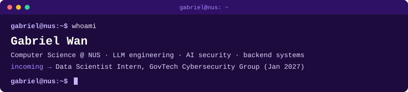

I like turning messy, real-world problems into **software people actually use**.

<pre>
<a href="https://github.com/gabriel-wan/tencent-hackathon-fintech"><b>KnowBuddy</b></a>         permission-aware RAG over Slack, Drive, Jira and Confluence
                  0 permission leaks in evaluation · 30/30 prompt-injection attacks resisted
<a href="https://github.com/gabriel-wan/mini-gabriel"><b>mini-gabriel</b></a>      Qwen3-8B fine-tuned with LoRA to write like me
                  style distance cut 83% vs. the base model · runs on a laptop CPU
<a href="https://github.com/gabriel-wan/kopikaki"><b>KopiKaki</b></a>          voice-first meetups for seniors, built on Gemini Live function calling
<a href="https://github.com/Hypovolemic/uwash-bot"><b>UWash</b></a>             IoT laundry tracking for UTown · Top 8, NUS Student Life Hackathon 2026
<a href="https://github.com/Garuda-Techs/LoungeBookingBot"><b>LoungeBookingBot</b></a>  Telegram Mini App for booking residence lounges · 130+ users
<a href="https://github.com/8starlabs/ui"><b>8starlabs/ui</b></a>      open-source contributor · component library built on shadcn/ui
</pre>

<pre>
languages    Python · Java · TS/JS · C · SQL
ml / llm     PyTorch · Unsloth (LoRA) · RAG · pgvector
backend      FastAPI · Flask · Node.js · PostgreSQL · Docker
frontend     React · Next.js · Firebase
</pre>

<pre>
<a href="https://gabrielwan.me">portfolio</a> · <a href="https://linkedin.com/in/gabrielwanjp">linkedin</a>
</pre>
